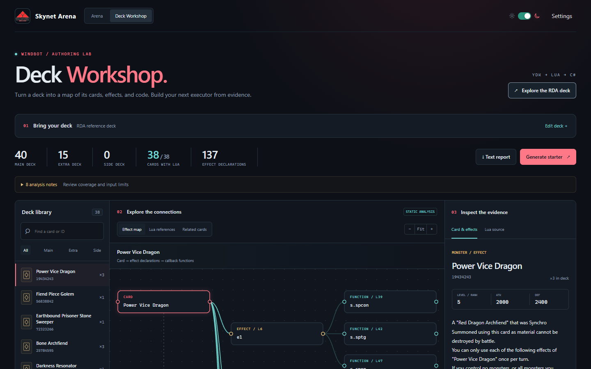

# Deck Workshop

[Workspace](../README.md) · [Arena setup](../Arena/README.md#start) · [WindBot authoring](../WindBot/Guides/ExecutorAuthoring.md)

Open a deck list, choose a card, and follow its effects into the Lua source that implements them. Workshop runs inside Arena and includes versioned local card databases and scripts.

| Task | Standard | Rush |
| --- | --- | --- |
| Explore card text, effects, scripts and related cards | Yes | Yes |
| Download a combined text and Lua report | Yes | Yes |
| Generate a C# starter for normal WindBot | Yes | Research and reports only |

## Open the workshop

On Windows with Node.js 24, double-click [Skynet Arena.cmd](<../Arena/Skynet Arena.cmd>). For a manual launch on Windows or Linux, run the following from the workspace root.

```sh
cd Arena
npm ci
npm run build
npm start
```

Open [Deck Workshop on localhost](http://127.0.0.1:3000/#workshop). Deck analysis works without a running duel server.

1. **Load a list.** Select **Explore the RDA deck** to open The Crimson King example. For your own list, choose Standard or Rush, then drop, select or paste a `.ydk` and analyze it.
2. **Trace one effect.** Pick a card in the library. In **Effect map**, select an effect or callback to open its numbered Lua source. Compare it with the printed text and database prompt strings in the inspector.
3. **Explore or export.** **Lua references** shows literal card IDs. **Related cards** groups static relationships. **Text report** downloads the combined text and Lua for the whole deck.



## Integrate a Standard starter

Enter a unique executor name and select **Generate starter**. Preview or download the source, deck, analysis, instructions and manifest. The generator leaves installation and compilation to you.

| Export | Destination in this checkout |
| --- | --- |
| `<Name>Executor.cs` | `WindBot/Game/AI/Decks/`. The single file contains the card IDs, planner scaffold, model hooks and prompt callbacks. |
| `.ydk` | `WindBot/Decks/`, using the filename shown in the export. |
| Manifest, report and instructions | Keep these with your development records. Deck-specific fixtures and launchers belong in `WindBot/Tools/Executors/<deck>/`. |

The [WindBot project](../WindBot/WindBot.csproj) automatically includes files named `*Executor.cs` in that folder and packages deck lists from `Decks/`. A starter registers as `Test` with its model disabled. Implement its effects and prompts before making it available to normal play. [RDA template](../WindBot/Templates/RdaPlannerExecutor.cs.template) · [Registration and packaging](../WindBot/Guides/ExecutorAuthoring.md#register-and-package-the-whole-executor)

Run these commands from the workspace root. The example checks the bundled RDA deck. For a generated starter, substitute its registration and deck file. Choose a new output directory for each run and use `python3` on Linux.

```sh
python WindBot/Tools/bot_tool.py doctor --database DeckWorkshop/Data/standard/cards.cdb
python WindBot/Tools/bot_tool.py build --configuration Release
python WindBot/Tools/bot_tool.py check --configuration Release --database DeckWorkshop/Data/standard/cards.cdb --deck WindBot/Decks/AI_TheCrimsonKing.ydk --registration TheCrimsonKing --output Artifacts/workshop-runtime-check
```

A successful receipt verifies native SQLite, the deck's card IDs and the compiled registration. Test the actual plays against the host scripts. [Build prerequisites](../WindBot/README.md#build-and-check-on-windows-or-linux) · [Executor testing](../WindBot/Guides/ExecutorAuthoring.md#test-correctness-before-comparing-strength)

## Included data and provenance

| Snapshot | Cards | Lua files, including helpers | Original inputs |
| --- | ---: | ---: | --- |
| Standard | 15,019 | 13,575 | `locales/en-US/cards.cdb`, `script.zip` |
| Rush | 4,224 | 3,920 | `locales/en-US/rush_cards.cdb`, `rush_scripts.zip` |

The inputs came from the explicitly selected
`D:/Programs/GitHub/MDPro4_Data/Data`. **Both CDBs and all extracted scripts are
tracked in Git.** `Data/standard/cards.cdb` and `Data/rush/cards.cdb` are the local
database paths. Edison is excluded. Archive licenses and metadata are retained;
`script/` archive members appear under each snapshot's `scripts/` directory.
The data remains subject to its original attribution and licenses.

### Optional Bakura prerelease overlay

The optional `Expansions/bakura-prerelease/` snapshot contains only the selected
**Dark Necrofear, the Ruler of Demise** (`100268007`) database rows and unchanged
Lua from `D:/Games/MDPro4/Expansions/ygopro-super-pre.ypk`. Its provenance records
the source archive, source database and imported hashes. Evil Lord - Zorc
(`73320394`) and Spirit Shield (`8324284`) already belong to Standard. This
overlay does not replace the released Standard/Rush snapshots or their relation
indexes. Workshop's Standard catalog therefore remains the released snapshot.

Prepare matching bot/duel-host inputs on Windows or Linux (use `python3` on Linux):

```sh
python DeckWorkshop/prepare_runtime.py --expansion DeckWorkshop/Expansions/bakura-prerelease --output Artifacts/bakura-data
```

Run this from the workspace root and choose a new output directory each time.
The result contains `locales/en-US/cards.cdb`, `script.zip`, and a hash receipt.
Point WindBot at that CDB and the duel host at the same CDB and script archive.
No external installation is modified. Shared Lua helpers stay at the Standard
snapshot; unrelated prerelease cards are excluded. The exporter rejects changed
overlay hashes and collisions with released IDs, so a future released Necrofear
requires an explicit ID/data migration. Omit `--expansion` for Standard alone.

```sh
python -m unittest discover -s DeckWorkshop -p test_prepare_runtime.py -v
```

### Verify or refresh the snapshots

The original `Pull.py` and deck inputs in
`D:/Modding/Private Workshop/Deck Compiler` informed the combined-report workflow.
Their reference hashes are retained in `data-provenance.json`, but the legacy
compiler is not bundled. The new report reads the selected CDB and matching Lua
snapshot directly; it does not use the old machine-specific translation paths,
generated report or duplicate/pre-release scripts.

The [data provenance receipt](data-provenance.json) records source archive/database hashes and every imported
file's hash. `.gitattributes` preserves their original bytes and line endings.
Verify a checkout with:

```sh
python DeckWorkshop/import_data.py verify
```

To review a future refresh, import into a new directory; the importer refuses
to overwrite an existing snapshot:

```powershell
python DeckWorkshop/import_data.py import --data-root 'D:/YourGame/Data' --output Artifacts/workshop-refresh
```

Optional `--compiler-root` records reference hashes without copying that compiler.
Compare the files and provenance before replacing the tracked snapshots. Restart
Arena after refreshing data and rebuild the related indexes using the command below.
Runtime lookup stays inside these workspace snapshots, never external game paths.

## RelatedCards integration

The supplied `MDPro_3/Tools/RelatedCards` parser is copied into `RelatedCards/`.
Its source revision and hashes are in the [RelatedCards provenance receipt](RelatedCards/provenance.json); the parser
is unchanged and the imported tests only adapt their Python import path.
It recognizes named IDs, aliases, static archetype/type/race/level predicates,
and supported Rush Maximum/Fusion/material/filter/alternate helpers.

`Relations/standard.json.gz` and `Relations/rush.json.gz` are versioned indexes
generated from the imported snapshots. They contain 13,852 and 3,943 indexed
cards respectively, with 4,094,243 categorized edges in total. Edges can be
inverse links or overlapping categories, not unique combos. The UI prioritizes
deck members, then named-ID and archetype relationships, and shows at most 24
related cards per selected card. These are research leads, not ranked deck edits.

```sh
python DeckWorkshop/build_relations.py
python -m unittest discover -s DeckWorkshop/RelatedCards/tests -v
```

The wrapper passes explicit snapshots and shared standard constants to the Rush
parser, then produces deterministic compressed indexes. Use this wrapper rather
than the imported builder's game-specific default CLI. No Lua is executed.

## Limits and validation

This is static source analysis, not a Lua interpreter or a duel simulator. Dynamic
helpers, cloned effects, scopes, branches and prompt ordering can be incomplete.
Prompt-string offsets are not printed effect-paragraph numbers. Missing cards,
ambiguous scripts, alias fallback and source limits are surfaced. A `.ydk` is
preserved without claiming banlist or format legality. Standard analysis also
does not automatically establish a deck's strategy or competitive strength.

Inputs are limited to 32 KiB and 200 total card copies. Individual scripts are
limited to 256 KiB and combined Lua to 4 MiB per analysis. Function/effect/reference
inventories are bounded. Rush supports analysis, relationships and reports;
executor generation is disabled because this WindBot runtime has not been
validated for Rush rules.

The original 2026-11-02 Windows validation recorded byte verification of all 17,500 imported
files; ten RelatedCards fixtures; Arena backend tests and production build;
WindBot Debug/Release; two generated starters compiled together as C# 6;
runtime SQLite/deck/registry checks; RDA 14/14, Voiceless 39/39 and Metalmorph
31/31 offline checks. Browser checks cover the analysis, source graph and export
flows. These are separate from real-duel outcomes: no duels or strength comparison
were performed for this update. Linux commands and Mono launch paths are supplied,
but local WSL could not start, so Linux execution remains unverified.
