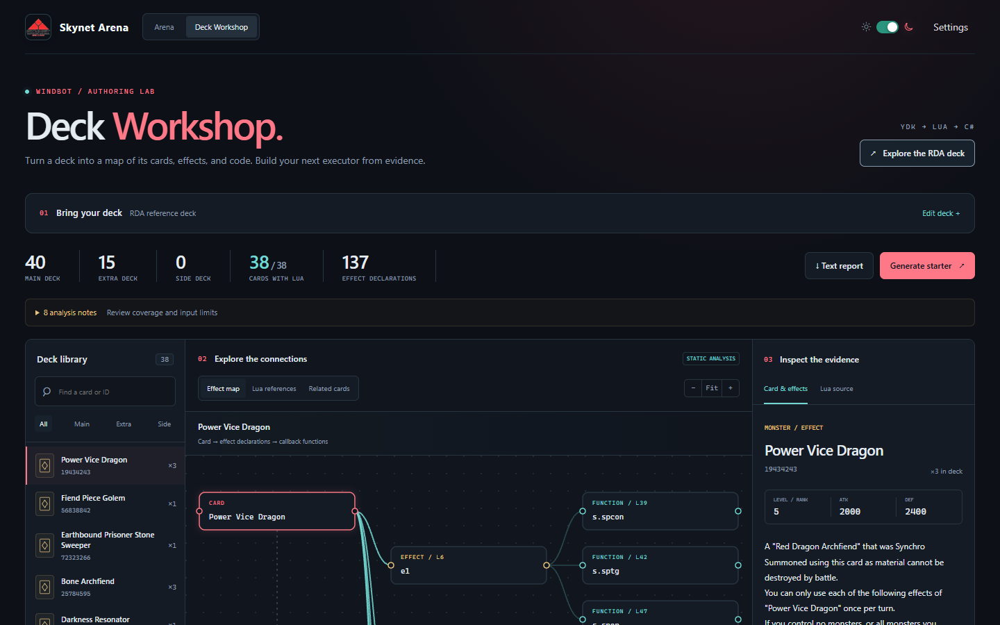

# MDPro4 Duel AI

Write a bot for a favorite deck, train an experimental duel policy, or compare two builds over real matches. **WindBot** runs deck-specific C# executors. **SKYNET** chooses among legal offers using shared card knowledge. **Arena** hosts the deck workbench and records match results for either bot.

| What do you want to do? | Start here |
| --- | --- |
| Play against an existing bot | [Build WindBot and select a deck](WindBot/README.md#build-and-check-on-windows-or-linux) |
| Write or improve a deck executor | [Authoring guide](WindBot/Guides/ExecutorAuthoring.md) · [Copyable request](WindBot/Guides/ExecutorAuthoring.md#copyable-starter-prompt) · [C# starter template](WindBot/Templates/RdaPlannerExecutor.cs.template) |
| Understand the cards in a `.ydk` file | [Explore Deck Workshop](DeckWorkshop/README.md) |
| Collect training episodes or evaluate a candidate | [Run SKYNET](SKYNET/README.md#build-and-run) · [Training workflow](SKYNET/README.md#can-it-teach-itself) |
| Compare two bots or investigate a loss | [Set up Arena](Arena/README.md) · [Read WindBot duel traces](WindBot/README.md#duel-traces) |

## First visit? Open the example deck

On Windows, install Node.js 24 and double-click [Skynet Arena.cmd](<Arena/Skynet Arena.cmd>). On first launch it installs dependencies and builds the dashboard. Open [Deck Workshop on localhost](http://127.0.0.1:3000/#workshop) and select **Explore the RDA deck**. Choose a card, then an effect in the center graph to see the Lua that implements it. The sample works offline once the dashboard and bundled data are installed. [Linux and manual setup](Arena/README.md#start)

[](DeckWorkshop/README.md)

Workshop can analyze Standard and Rush decks. For Standard decks it can also export a single C# executor starter. The starter enters WindBot under a `Test` registration with its model disabled until you implement the card decisions. [Export and integrate a starter](DeckWorkshop/README.md#integrate-a-standard-starter)

## Build the bots

From the repository root, use a Visual Studio Developer PowerShell with the .NET Framework 4.8 targeting pack installed.

```powershell
msbuild WindBot/WindBot.sln /p:Configuration=Release /p:Platform="Any CPU"
msbuild SKYNET/Skynet.sln /p:Configuration=Release /p:Platform="Any CPU"
```

| Build output | Use it for |
| --- | --- |
| `WindBot/bin/Release/WindBot.exe` | Join a compatible duel host with a registered deck. [Run and check WindBot](WindBot/README.md) |
| `WindBot/BotWrapper/bin/Release/Bot.exe` | Launch a normal bot through the game's English roster. [Launcher layout](WindBot/README.md#botwrapper) |
| `SKYNET/bin/Release/SKYNET.exe` | Run the general policy or a frozen expert. [SKYNET options and examples](SKYNET/README.md) |

WindBot's Python launcher can discover MSBuild on Windows or use Mono on Linux. To verify a build before joining a duel, run these commands from the repository root. Give each check a new output directory.

```powershell
python WindBot/Tools/bot_tool.py build --configuration Release
python WindBot/Tools/bot_tool.py check --configuration Release --database DeckWorkshop/Data/standard/cards.cdb --deck WindBot/Decks/AI_TheCrimsonKing.ydk --registration TheCrimsonKing --output Artifacts/first-windbot-check
```

## From a build to a match

- **Play one duel.** Start a compatible host, select its matching card database and scripts, and connect the bot. A registration check verifies the deck and database locally. [WindBot connection example](WindBot/README.md#join-a-duel)
- **Compare builds.** Configure Arena's dedicated `arena-srvpro` server and both participant profiles in **Settings**. Keep binaries, decks, database and opponents fixed for a comparison. Arena takes match outcomes from the server rankings. [Arena setup and scoring](Arena/README.md)
- **Train a policy.** SKYNET collects episodes only when explicitly enabled. Train a candidate offline and select it explicitly for fresh, frozen evaluation. [SKYNET training and evaluation](SKYNET/README.md#can-it-teach-itself)

## Where files belong

| Files | Location |
| --- | --- |
| Registered WindBot decks and their checks | One `*Executor.cs` per deck in [Game/AI/Decks](WindBot/Game/AI/Decks/). Put deck-specific fixtures and launchers under [Tools/Executors](WindBot/Tools/Executors/). |
| Card data and scripts | [Deck Workshop snapshots](DeckWorkshop/README.md#included-data-and-provenance) include Standard and Rush. Use inputs matching the live host's rules and scripts. |
| Normal bot roster and dialogs | [BotWrapper/bot.conf](WindBot/BotWrapper/bot.conf) lists normal WindBot registrations. Both bots ship their own dialogs, with `default.json` copied from `Universal.EN.json`. [Resource origins and hashes](WindBot/resource-provenance.json) |
| Local results | Put logs and validation receipts in ignored `Artifacts/`. Arena saves settings and history in `Arena/data/` by default. |

Contributor instructions are available for the [workspace](AGENTS.md), [WindBot](WindBot/AGENTS.md), [SKYNET](SKYNET/AGENTS.md), and [Arena](Arena/AGENTS.md). WindBot and SKYNET retain the original WindBot/YGOSharp attribution. [License](LICENSE)

## Following a pull request

Open **Checks** on a pull request to `main` to follow the Windows builds and offline tests, Arena tests, legacy Mono builds, and macOS Solo dialog check. Pushing another commit replaces that PR's older run. Open the workflow run's **Summary** for the tested revision, each result and a link to its job log. Successful Windows builds also attach WindBot and SKYNET packages. [Validation runs](https://github.com/ElderLich/SKYNET/actions/workflows/test-build.yml)

From the PR branch, run `gh pr checks --watch` to follow the checks live. For another contributor's PR, supply its number, for example `gh pr checks 42 --watch`. [GitHub CLI reference](https://cli.github.com/manual/gh_pr_checks)
